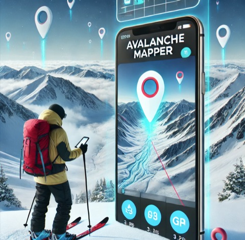

<p align="center">
  
</p>

# AvalancheMapper — TypeScript edition

[](https://github.com/deuber/AvalancheMapper-TS/actions/workflows/deploy.yml)

Upload a photo taken at an avalanche site; the app reads the GPS coordinates out
of the image's EXIF metadata and drops a pin on a topo map. No manual coordinate
entry, no server, nothing uploaded.

**Live: [deuber.github.io/AvalancheMapper-TS](https://deuber.github.io/AvalancheMapper-TS/)**

This is a ground-up TypeScript rewrite of my original vanilla-JS
[AvalancheMapper](https://github.com/deuber/AvalancheMapper)
([live](https://deuber.github.io/AvalancheMapper/)). Same purpose, but with a
typed, tested, CI-built codebase, and fixes for several bugs I found while
porting it.

## Why this version exists

I built the original as a plain-JavaScript tool for my own backcountry
observations. I rebuilt it in TypeScript to show how I work in a language I
hadn't used professionally.

Most of my experience is in Python, but the skills that carry over don't
depend on the language: reading unfamiliar code, finding the root cause of a
bug, and proving the fix with a test. While porting, I found and fixed eight
bugs in my own v1. They're listed under [Debugging notes](#debugging-notes-bugs-found-in-v1-while-porting).

I used [Claude Code](https://claude.com/claude-code) as a pair programmer,
the same way I'd use any modern tool to get productive in a new codebase
quickly. I reviewed and verified every change myself.

## Why the tool exists

As a backcountry skier I sometimes send avalanche observations to the
[Sierra Avalanche Center](https://www.sierraavalanchecenter.org/observations)
and [Utah Avalanche Center](https://utahavalanchecenter.org/node/add/avalanche).
Neither lets you paste in coordinates taken straight from a photo, and copying
lat/lng off a phone by hand is error-prone. This closes that gap.

## Features

- **Reads GPS from JPEG, HEIC (iPhone), PNG and TIFF** using [exifr](https://github.com/MikeKovarik/exifr)
- **Photo details**: capture time, elevation (ft and m) and camera, which are useful for an observation report
- **Copy-ready output** in decimal degrees and degrees/minutes/seconds
- **Manual entry** that accepts decimal (`39.166175, -120.155778`), DMS
  (`39°08'24.9"N 120°14'06.0"W`), DDM (`39°8.415'N 120°14.1'W`), and common
  spacing/glyph variants (`′ ″`, `d m s`), with inline validation errors
- **Drag the pin or click the map** to fine-tune
- Topo base map from [OpenTopoMap](https://opentopomap.org/) via [Leaflet](https://leafletjs.com/), with a ft/m scale bar; no API key needed
- **Private**: everything runs in the browser and the photo never leaves the device

## Project layout

```
src/
  coords.ts   Pure coordinate parsing/formatting; returns a typed ParseResult union
  exif.ts     exifr wrapper: narrows `unknown` EXIF into a PhotoMetadata union
  map.ts      MapView class wrapping Leaflet (private #fields, typed callbacks)
  dom.ts      byId<T>() typed element lookup + XSS-safe status rendering
  main.ts     UI wiring; exhaustive switch over PhotoMetadata
tests/
  coords.test.ts  Parser/formatter cases, including v1 regressions
  exif.test.ts    Unit tests + end-to-end: writes GPS EXIF into a real JPEG, reads it back
.github/workflows/deploy.yml   typecheck → test → build → deploy to GitHub Pages
```

## TypeScript choices

- **Strictest practical config**: `strict`, `noUncheckedIndexedAccess`,
  `exactOptionalPropertyTypes`, `verbatimModuleSyntax`. There's no `any` and no
  unchecked `as` casts in app code.
- **Errors as values.** `parseCoordinates()` returns
  `{ ok: true, value } | { ok: false, error }`, so the compiler won't let the
  caller skip the failure case. v1 threw, and the caller showed an `alert()`.
- **A typed trust boundary.** exifr's output is typed `any`. `interpretExif()`
  takes it as `unknown` and checks every field it uses at runtime (wrong-typed
  values are dropped, not trusted). It returns
  `PhotoMetadata = gps | no-gps | error`.
- **Exhaustiveness checking.** `main.ts` switches on `meta.kind` with a `never`
  default, so adding a new variant won't compile until every consumer handles it.
- **Typed DOM.** `byId("map", HTMLDivElement)` checks at runtime that the
  element exists and has the right type, then returns it correctly typed, so no
  `as HTMLInputElement` casts are needed.
- **Local declarations for an untyped dependency.** `piexifjs` (test-only) ships
  no types, so `src/types.d.ts` declares only the parts that are used.

## Debugging notes: bugs found in v1 while porting

| # | Bug in v1 | Cause | Fix / guard in v2 |
|---|-----------|-------|-------------------|
| 1 | `39°08'24.9"s 120°14'06.0"w` was placed in the **northern/eastern** hemisphere | The DMS regex was case-insensitive (`/i`), but the sign check compared against uppercase `"S"`/`"W"` only | Hemisphere is normalized to a `Hemisphere` union type. Regression test added |
| 2 | PNG uploads (allowed by the file picker) **never** returned GPS | exif-js only parses JPEG and gives up silently on anything else | exifr handles JPEG, HEIC, PNG and TIFF. Real read failures show up as an `error` status |
| 3 | iPhone HEIC photos couldn't be selected at all | `accept` listed JPEG/PNG only | HEIC/HEIF accepted. If the browser can't show a HEIC thumbnail, the preview is hidden instead of showing a broken image |
| 4 | Out-of-range input such as `91, 200` was silently accepted | No range validation | Range checks on lat/lng and on minutes/seconds (< 60) |
| 5 | An empty, broken preview box showed on page load | `.upload-result { display:flex }` overrode the UA's `[hidden]` rule | Global `[hidden]{display:none !important}` |
| 6 | Dragging the pin updated the text box, but typing coordinates didn't update the readout. Enter didn't submit | Readout logic only ran on some code paths | Single `showPosition()` path. Manual entry is a real `<form>` |
| 7 | Phones with no satellite lock that write `0,0` sent the pin to the Gulf of Guinea | No sanity check | A `0,0` fix is treated as "no GPS" |
| 8 | Leaflet markers break under any bundler (a common Leaflet + Vite/Webpack issue) | Leaflet guesses icon URLs from its CSS path | Icons are imported explicitly so Vite fingerprints/inlines them |

## Run it

```bash
git clone https://github.com/deuber/AvalancheMapper-TS.git
cd AvalancheMapper-TS
npm ci
npm run dev        # http://localhost:5173/AvalancheMapper-TS/
npm test           # vitest
npm run build      # typecheck + production build into dist/
```

## License

MIT; see [LICENSE](LICENSE).
